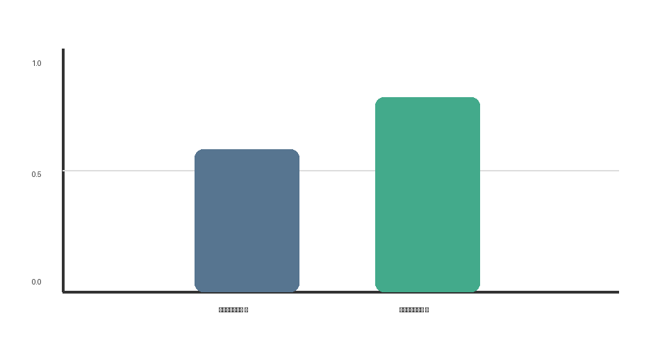

{{json
{
  "discipline": "[Название дисциплины и СУБД]",
  "title": "[Полное название работы]",
  "student": {"name": "[Фамилия Имя Отчество]", "course": "[курс]", "group": "[номер группы]", "program": "[код и название направления]"},
  "teacher": {"title": "[должность, степень]", "name": "[Фамилия Имя Отчество]"},
  "institution": {"short": "ОмГТУ", "department": "ПМиФИ", "year": "[год]"},
  "work": {"type": "Домашнее задание"}
}
}}

Укажите `work.variant` только если у задания есть номер варианта. Если поля нет или оно пустое, отдельная строка варианта на титульнике не выводится.

# АННОТАЦИЯ

[Кратко укажите тему, объект работы, цель и основные результаты. Удалите этот текст после заполнения.]

# СОДЕРЖАНИЕ

# ВВЕДЕНИЕ

[Опишите тему и её актуальность. Обозначьте цель работы.]

Цель работы — [сформулируйте цель]. Для её достижения необходимо решить следующие задачи:

1. [Первая задача.]
2. [Вторая задача.]
3. [Третья задача.]

# ОСНОВНАЯ ЧАСТЬ

[Этот структурный заголовок можно не указывать: если он пропущен, конвертер ФИТ вставит его перед первым заголовком `##` или `###` после введения. Структурные названия введения, заключения и списка литературы будут оформлены как заголовки первого уровня, даже если в Markdown ошибочно указать `##` или `###`.]

## [Название первого раздела]

[Основной текст. Отделяйте абзацы друг от друга пустой строкой. Можно использовать **полужирный текст**, *курсив*, `фрагменты кода` и [ссылки](https://example.org). Ссылку на источник в тексте укажите так: [1]. Номер заголовка `##` в профиле ФИТ добавляется автоматически; номера подзаголовков `###` указывайте вручную.]

### 1.1 [Название подраздела]

[Изложите ход работы, методику или исходные условия. Номер первого заголовка второго уровня будет `1.`, следующий — `2.`. Номер подраздела третьего уровня, например `1.1`, укажите в его заголовке.]

Для маркированного перечня используйте обычный список:

- [Первый пункт.]
- [Второй пункт.]
- [Третий пункт.]

Для последовательности действий используйте нумерованный список:

1. [Первое действие.]
2. [Второе действие.]
3. [Третье действие.]

**Не используйте заголовки четвёртого уровня.** Профили настраивают только уровни `#`, `##` и `###`.

Вместо него применяйте `###` для подразделов и вносите номер в текст заголовка.

## [Название второго раздела]

[Перед таблицей или рисунком сначала объясните в тексте, что именно будет показано.]

Таблица: [Название таблицы без точки в конце]

| Показатель | Вариант А | Вариант Б |
|---|---:|---:|
| [Показатель 1] | [Значение] | [Значение] |
| [Показатель 2] | [Значение] | [Значение] |

[После таблицы объясните её результаты.]

Рисунок показывает [краткое описание того, что нужно увидеть читателю].



[Каждое изображение должно быть отдельным абзацем. Путь к файлу указывается относительно этого Markdown-файла. Текст в квадратных скобках станет подписью.]

### 2.1 [Название следующего подраздела]

[Можно добавить несколько таблиц, рисунков и листингов. Нумерация каждого вида объектов начинается с 1 и увеличивается автоматически.]

Таблица: [Название следующей таблицы]

| Поле | Описание |
|---|---|
| [Поле 1] | [Описание поля 1] |
| [Поле 2] | [Описание поля 2] |


Листинг: [Название фрагмента программы]

```python
# Вставьте сюда необходимый фрагмент программы.
values = [0.91, 0.94]
print(max(values))
```

[Код сохраняется как отдельный блок и оформляется шрифтом кода из профиля. Указание `python` после обратных кавычек — подсказка для читателя Markdown.]

### 2.2 [Подраздел с формулами или результатами]

[Встроенная формула записывается между одинарными знаками `$`, отдельная формула — между двойными `$$`. Конвертер преобразует TeX в редактируемое уравнение Word. Автоматическая нумерация формул не выполняется.]

Из формулы $a^2 + b^2 = c^2$ можно извлечь длину гипотенузы.

$$
c = \sqrt{a^2 + b^2}
$$

# ЗАКЛЮЧЕНИЕ

[Подведите итоги работы. Скажите, достигнута ли поставленная цель.]

По результатам работы:

- [Укажите, что было сделано.]
- [Укажите, что удалось установить или получить.]
- [При необходимости укажите ограничения результата.]

# СПИСОК ИСПОЛЬЗОВАННЫХ ИСТОЧНИКОВ

- [Фамилия, И. О. Название книги : вид издания / И. О. Фамилия. — Город : Издательство, год. — N с. — Текст : непосредственный.]
- [Название сайта : [сайт] / Организация. — URL: https://example.org/ (дата обращения: ДД.ММ.ГГГГ). — Текст : электронный.]

Сверьте состав и порядок элементов с видом ресурса и требованиями задания. Профиль сохраняет пунктуацию записей и оформляет их абзацный отступ; автоматически достраивать отсутствующие библиографические сведения конвертер не может.

[Если приложения должны начинаться с новой страницы, поставьте строку `---` перед заголовком ниже. Удалите разделитель, если разрыв не нужен.]

---

# ПРИЛОЖЕНИЯ

[При необходимости добавьте материалы приложений. Для нескольких приложений укажите обозначения и названия отдельными заголовками.]
