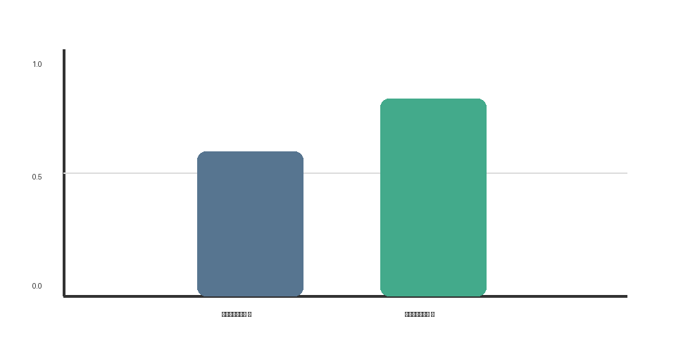

{{json
{
  "discipline": "[Название дисциплины]",
  "title": "[Тема работы]",
  "student": {"name": "[Фамилия Имя Отчество]", "course": "[курс]", "group": "[группа]", "program": "[код и название направления]"},
  "teacher": {"title": "[должность и степень]", "name": "[Фамилия Имя Отчество]"},
  "institution": {"short": "ОмГТУ", "department": "ПМиФИ", "year": "[год]"},
  "work": {"type": "Домашнее задание"}
}
}}

Если у работы есть номер варианта, добавьте в объект `work` поле `"variant": "1"`. Без этого поля строка варианта на титульнике не выводится.

# СОДЕРЖАНИЕ

# ВВЕДЕНИЕ

Кратко опишите тему, её актуальность, цель и задачи работы.

# ОСНОВНАЯ ЧАСТЬ

[Заголовок можно пропустить: конвертер добавит его перед первым подразделом после введения.]

## Название раздела

Введите основной текст раздела. Отделяйте абзацы пустой строкой.

### 1.1 Название подраздела

Добавьте описание выполненной работы и объясните полученные результаты.

Перед таблицей сначала упомяните её в тексте.

Таблица: Название таблицы

| Столбец 1 | Столбец 2 |
|---|---|
| Значение | Значение |

Перед рисунком сначала упомяните его в тексте. Изображение должно лежать рядом с Markdown-файлом в папке `images`.



Листинг: Название листинга

```python
# Вставьте сюда код
print("Пример")
```

# ЗАКЛЮЧЕНИЕ

Подведите итоги: укажите, достигнута ли цель и какие задачи выполнены.

# СПИСОК ИСПОЛЬЗОВАННЫХ ИСТОЧНИКОВ

1. Автор, инициалы. Название ресурса. — Место : Издательство, год. — Объём.
2. Организация. Название электронного ресурса. — Текст : электронный. — URL: https://example.org/ (дата обращения: ДД.ММ.ГГГГ).
