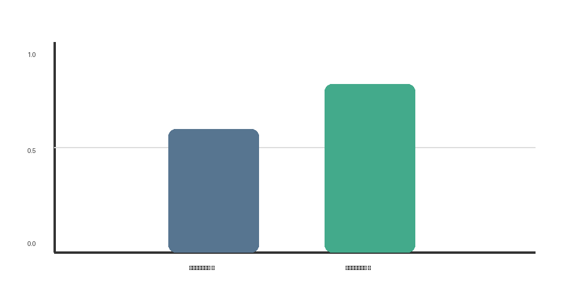

{{json
{
  "discipline": "Анализ данных",
  "title": "Анализ результатов эксперимента",
  "student": {"program": "00.00.00 Название направления"},
  "work": {"variant": "1"}
}
}}

# СОДЕРЖАНИЕ

# ВВЕДЕНИЕ

Цель работы — **сравнить** результаты *двух вариантов* обработки данных и представить их в наглядной форме. Описание формата доступно в [документации Python](https://docs.python.org/3/).

Для решения задачи выполнены подготовка данных и анализ результатов.

## 1 Основная часть

### 1.1 Сравнение результатов

Таблица: Сравнение вариантов

| Показатель | Вариант А | Вариант Б |
|---|---:|---:|
| Точность | 0,91 | 0,94 |
| Время, с | 2,8 | 3,1 |

На рисунке показана итоговая диаграмма.



Листинг: Подготовка массива данных

```python
values = [0.91, 0.94]
print(max(values))
```

# СПИСОК ИСПОЛЬЗОВАННЫХ ИСТОЧНИКОВ

- Иванов, И. И. Основы анализа данных : учебное пособие / И. И. Иванов. — Москва : Учебная литература, 2024. — 256 с. — Текст : непосредственный.
- Python 3 Documentation : [сайт] / Python Software Foundation. — URL: https://docs.python.org/3/ (дата обращения: 23.09.2026). — Текст : электронный.
